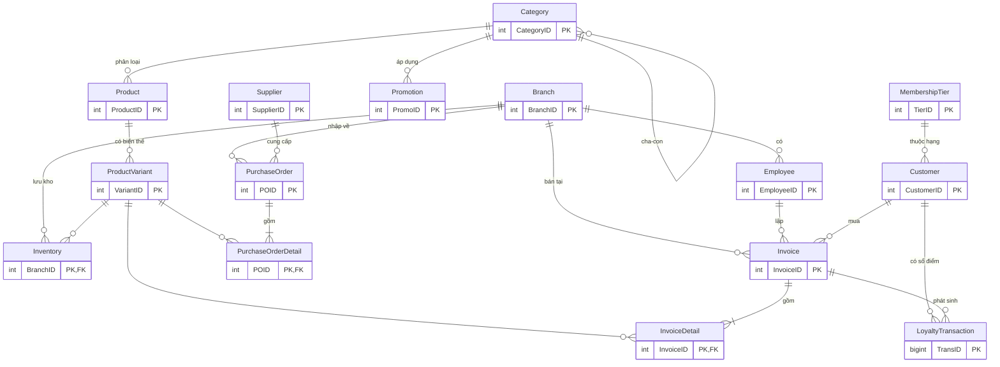

# 🛍️ Quản lý chuỗi cửa hàng bán lẻ thời trang & tích điểm khách hàng

> Đồ án môn **Cơ sở dữ liệu nâng cao** – Phân tích và thiết kế cơ sở dữ liệu cho hệ thống quản lý chuỗi cửa hàng bán lẻ thời trang kết hợp chương trình khách hàng thân thiết.

**DBMS:** Microsoft SQL Server 2019+ (T-SQL) · **Công cụ:** SQL Server Management Studio / Azure Data Studio

---

## 1. Giới thiệu bài toán

Một doanh nghiệp thời trang có nhiều chi nhánh ở các tỉnh/thành. Hệ thống cần:

- Quản lý **chi nhánh, nhân viên**.
- Quản lý **sản phẩm** theo danh mục, mỗi sản phẩm có nhiều **biến thể** (size, màu) với giá vốn/giá bán.
- Quản lý **tồn kho theo từng chi nhánh**, **nhập hàng** từ nhà cung cấp.
- Bán hàng: lập **hóa đơn**, áp dụng **khuyến mãi**, thanh toán nhiều hình thức.
- **Tích điểm khách hàng**: tích điểm theo giá trị hóa đơn, đổi điểm giảm giá, **phân hạng thành viên** (Đồng/Bạc/Vàng/Kim cương) với ưu đãi riêng.
- Báo cáo: doanh thu, hàng bán chạy, tồn kho thấp, phân khúc khách hàng.

## 2. Quy tắc nghiệp vụ tích điểm

| Quy tắc | Giá trị |
|---|---|
| Tích điểm | 10.000đ thanh toán = 1 điểm × hệ số hạng |
| Đổi điểm | 1 điểm = 1.000đ giảm giá |
| Xét hạng | Theo `LifetimePoints` (điểm tích lũy trọn đời, không bị trừ khi đổi điểm) |
| Hạng | Đồng (0) · Bạc (≥100, giảm 3%, ×1.2) · Vàng (≥300, giảm 5%, ×1.5) · Kim cương (≥800, giảm 8%, ×2.0) |
| Khuyến mãi | Theo danh mục (hoặc toàn sàn) trong khoảng ngày, lấy mức giảm cao nhất |
| Khách vãng lai | Được mua hàng nhưng không tích/đổi điểm |
| Hủy hóa đơn | Hoàn kho, hoàn điểm đã đổi, thu hồi điểm đã tích |

## 3. Sơ đồ quan hệ thực thể (ERD)



### Danh sách bảng (15 bảng)

| Nhóm | Bảng | Mô tả |
|---|---|---|
| Tổ chức | `Branch`, `Employee` | Chi nhánh, nhân viên |
| Sản phẩm | `Category`, `Product`, `ProductVariant` | Danh mục (đa cấp), sản phẩm, biến thể size/màu (SKU) |
| Kho & nhập hàng | `Inventory`, `Supplier`, `PurchaseOrder`, `PurchaseOrderDetail` | Tồn kho theo chi nhánh, phiếu nhập |
| Khách hàng | `MembershipTier`, `Customer`, `LoyaltyTransaction` | Hạng thành viên, khách, sổ nhật ký điểm |
| Bán hàng | `Promotion`, `Invoice`, `InvoiceDetail` | Khuyến mãi, hóa đơn, chi tiết hóa đơn |

### Quyết định thiết kế đáng chú ý

1. **Tách `Product` / `ProductVariant`**: tồn kho và bán hàng theo SKU (size + màu), thông tin chung nằm ở `Product` → tránh lặp dữ liệu (3NF).
2. **`Inventory` khóa chính kép (BranchID, VariantID)**: tồn kho riêng từng chi nhánh, `CHECK (Quantity >= 0)` chặn âm kho ở tầng CSDL.
3. **`LoyaltyTransaction` là sổ cái điểm** (append-only): mọi cộng/trừ đều có dòng log; `Customer.Points` là số dư được duy trì và đối soát bằng view `vw_PointReconciliation`.
4. **Tách `Points` và `LifetimePoints`**: đổi điểm không làm khách bị tụt hạng.
5. **`LineTotal` là computed column PERSISTED**: tránh sai lệch giữa đơn giá, số lượng, % giảm.
6. **Hóa đơn có trạng thái** (Nháp → Hoàn tất / Đã hủy); trigger khóa chi tiết khi không còn là Nháp.
7. **Danh mục tự tham chiếu** (`ParentID`) cho cây danh mục; khuyến mãi áp dụng được cho cả danh mục cha.

## 4. Cấu trúc thư mục

```
fashion-retail-db/
├── README.md
├── .gitignore
└── database/
    ├── 01_schema.sql                 # Tạo database, bảng, ràng buộc
    ├── 02_functions_procedures.sql   # fn_GetTierID, sp_RegisterCustomer, sp_CheckoutInvoice, sp_CancelInvoice
    ├── 03_triggers.sql               # Tự nâng hạng, khóa hóa đơn, nhập kho tự động
    ├── 04_seed_data.sql              # Dữ liệu mẫu + chốt 7 hóa đơn demo
    ├── 05_views.sql                  # 5 view báo cáo
    ├── 06_queries.sql                # 11 truy vấn nâng cao (window, CTE đệ quy, PIVOT, RFM...)
    └── 07_indexes_security.sql       # Index, phân quyền theo role, backup
```

## 5. Hướng dẫn chạy

Chạy lần lượt theo thứ tự số trong SSMS / Azure Data Studio (hoặc bằng `sqlcmd`):

```bash
cd database
sqlcmd -S localhost -E -i 01_schema.sql
sqlcmd -S localhost -E -i 02_functions_procedures.sql
sqlcmd -S localhost -E -i 03_triggers.sql
sqlcmd -S localhost -E -i 04_seed_data.sql
sqlcmd -S localhost -E -i 05_views.sql
sqlcmd -S localhost -E -i 07_indexes_security.sql
sqlcmd -S localhost -E -i 06_queries.sql      # chạy thử các truy vấn
```

> ⚠️ `01_schema.sql` sẽ **xóa và tạo lại** database `FashionRetailDB`. Dữ liệu mẫu phải chạy trên DB mới để mã hóa đơn khớp 1–7.
> Dùng SQL Server trên Docker nếu chưa cài: `docker run -e ACCEPT_EULA=Y -e MSSQL_SA_PASSWORD='YourStrong!Pass1' -p 1433:1433 -d mcr.microsoft.com/mssql/server:2022-latest`

## 6. Kịch bản demo

```sql
-- Đăng ký khách mới
EXEC sp_RegisterCustomer N'Nguyễn Văn Test', '0999999999';

-- Tạo hóa đơn nháp, thêm hàng, chốt và đổi 20 điểm
INSERT INTO Invoice (BranchID, EmployeeID, CustomerID) VALUES (1, 2, 1);  -- giả sử InvoiceID = 8
INSERT INTO InvoiceDetail (InvoiceID, VariantID, Quantity, UnitPrice)
SELECT 8, VariantID, 1, ListPrice FROM ProductVariant WHERE SKU = 'SM-OXF-M-XAN';
EXEC sp_CheckoutInvoice @InvoiceID = 8, @PointsToUse = 20;

-- Xem hạng / điểm của khách, tồn kho thấp, đối soát điểm
SELECT * FROM vw_CustomerLoyalty;
SELECT * FROM vw_LowStock;
SELECT * FROM vw_PointReconciliation WHERE Difference <> 0;   -- phải rỗng

-- Hủy hóa đơn: hoàn kho + hoàn điểm
EXEC sp_CancelInvoice @InvoiceID = 8;
```

## 7. Nội dung kiến thức nâng cao được áp dụng

- Ràng buộc toàn vẹn: PK/FK/UNIQUE/CHECK, computed column, filtered index
- Stored procedure có **transaction + TRY/CATCH + THROW + UPDLOCK/HOLDLOCK** (xử lý tranh chấp khi nhiều quầy cùng bán)
- **Trigger** AFTER INSERT/UPDATE/DELETE, `MERGE`
- **View** báo cáo, `OUTER APPLY`
- **Window function** (`SUM OVER`, `LAG`, `DENSE_RANK`, `NTILE`), **CTE đệ quy**, **PIVOT**
- Chỉ mục (covering, filtered), phân quyền theo role, sao lưu/phục hồi

## 8. Hướng phát triển

- Điểm hết hạn (`EXPIRE`) theo job định kỳ
- Voucher sinh nhật / đổi quà
- Chuyển kho giữa chi nhánh, trả hàng một phần
- Partition bảng `Invoice` theo năm, Columnstore cho báo cáo
- Kết nối ứng dụng web/API (ASP.NET, Node.js)

## 9. 👥 Thành viên & phân công

| Thành viên | Vai trò | Công việc chính |
|---|---|---|
| **Nguyễn Hữu Trí** | Khởi tạo dự án & Thiết kế CSDL | Phân tích nghiệp vụ bán lẻ và tích điểm, thiết kế mô hình dữ liệu (ERD 15 bảng chuẩn 3NF), xây dựng file `01_schema.sql` (ràng buộc PK/FK/CHECK/UNIQUE, Computed Column Persisted), thiết lập chỉ mục (Covering/Filtered Index), phân quyền theo Role và chiến lược sao lưu trong `07_indexes_security.sql`. |
| **Hà Phương Bình** | Lập trình T-SQL & Xử lý nghiệp vụ | Xây dựng các hàm tính toán và Stored Procedures giao dịch trong `02_functions_procedures.sql` (`sp_RegisterCustomer`, `sp_CheckoutInvoice`, `sp_CancelInvoice` kết hợp `TRANSACTION`, `TRY...CATCH`, `UPDLOCK/HOLDLOCK`), phát triển các Trigger tự động nâng hạng, khóa hóa đơn và nhập kho trong `03_triggers.sql`. |
| **Nguyễn Quốc Duy** | Dữ liệu mẫu, Báo cáo & Truy vấn nâng cao | Khởi tạo bộ dữ liệu mẫu (Seed Data) chuẩn hóa và kịch bản demo trong `04_seed_data.sql`, thiết kế 5 View báo cáo quản trị và đối soát điểm trong `05_views.sql`, xây dựng 11 truy vấn phân tích chuyên sâu (Window Functions, CTE đệ quy cây danh mục, PIVOT doanh thu, phân khúc khách hàng RFM) trong `06_queries.sql`. |

**Giảng viên hướng dẫn:** Phan Đức Trí
